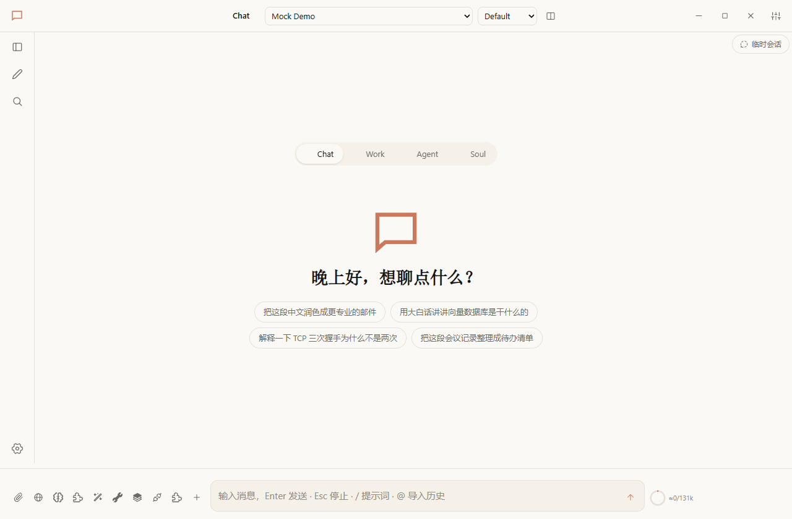

# SoloChat

**v0.4.3 · 一个单 exe，双击就是完整的本地 AI 聊天客户端。**

没有安装器、没有 npm、没有云端。源码在 `src/`，`node tools/build.mjs` 把界面、逻辑、图标、样式内联回一个 `index.html`；配上宿主壳后发布成**单个 exe（`SoloChatHost.exe`）**，托管 DLL、WebView2 加载器、页面统统嵌进这一个文件。拷到任何一台 Win10/11 机器，双击即用。



## 当前能力

### 对话与会话

- **Chat / Work / Agent / Soul 四种模式**：Chat 纯对话；Work 在内存沙箱里写文件、跑脚本、预览；Agent 读写真实工作区，写入逐次确认；Soul 长期记忆 + 本地工具（`/memory` 四页签、说「记住…」写入、`/dream` 巩固、`/learn` 沉淀技能、`/cron` 定时提醒，记忆落 `%USERPROFILE%\SoloChat\memory`）。
- **教材式公式**：`$…$` / `$$…$$` 里的 LaTeX 由内置解析器转成 MathML —— 分式分子在上、分母在下，根号罩住内容，上下标和各路括号按数学排版走；不联网、无第三方库。
- **Work / Agent 看页面**：`browser-read` 读渲染后的标题/正文/链接，`browser-act` 点按钮/填框/滚动/等待/前进后退；Steam 合集、加载更多、无限滚动都能先读 → 点 → 再读。
- **Agent 检索**：`grep <正则>` 逐行搜工作区回「路径:行号: 文本」，`glob **/*.cs` 按通配找文件；自动跳过依赖/构建目录。
- **Work 结构化提取**：`extract <url|-> --items ".item" --fields "name:.title,price:.price"` 按选择器抓字段，支持 `@属性`、`--next` 分页、`--dedupe`，输出 CSV 到工作区。
- **Work Python 沙箱**：`py` 围栏把工作区文本文件带进临时目录跑脚本，跑完把改动写回，目录即删；需安装 Python 3.11 运行时。
- **Chat 富文本**：任务列表、表格列对齐 + 横向滚动、脚注、定义列表、最多 3 层嵌套引用；9 种语言代码高亮（js/ts/py/java/cs/go/rs/sh/sql）。
- **Chat 生图 + 图片流**：输入区生图按钮，弹窗填提示词/尺寸/张数；支持上游 partial 帧渐进显示，完成后图片入附件库，刷新仍在，可下载/重新生成。
- **引用角标**：正文 `[1]` 变上标，悬停看标题/域名/摘要，点击跳到来源并高亮；没有来源的编号保持原文。
- **编辑重发可回退**：编辑用户消息并重发后，2 分钟内 `/rewind` 可恢复被截断的后续消息，并把编辑内容还原。
- **文档画布**：回答里的「画布」或 `/canvas` 打开，按会话分文档，可编辑/保存/回退历史版本（每文档 20 版），Ctrl+S 保存。
- **会话分组**：侧栏「+ 分组」创建一组 Chat/Work 会话，不绑定文件夹；组可设模式、模型、System Prompt、temperature、max_tokens，组内未覆盖的会话动态继承，删除分组保留会话。
- **会话隔离**：模型、模式、工具/插件/技能勾选跟会话走；同一会话内保留，切走不串，新建会话清空。
- **发送前调参**：输入区右侧 ⚙ 在第一条消息前也能打开「新会话（发送前）」，设置分组、模式、模型、提示词、温度与输出上限；请求按「会话 > 分组 > 全局」取生效模型。
- **Chat 选工具自动切 Work**：Chat 本身不执行工具；本轮勾了工具/插件时，发送前显式切到 Work 并提示，避免工具围栏没人执行。
- **流式与上下文**：SSE 流式渲染、中断/重试/继续、原地重新生成与多版本切换；上下文圆环实时估算，80% 自动压缩成 9 段摘要；网络瞬断自动重试一次。
- **提示词库**：设置页管理，输入 `/` 统一搜索所有扩展；提示词点选后直接插入正文。

### 扩展系统

- **六类内容**：智能体 / 插件 / 技能 / 工具 / 提示词 / MCP，统一走 `EXT.registry()`。
- **唯一 ID**：内置工具 `builtin:<name>`，用户条目 `tool:/skill:/agent:<name>`，提示词 `prompt:<name>`，插件 `plugin:<pkg>`，MCP `mcp:<name>`；同屏去重，旧内置工具选择自动迁移。
- **「/」统一搜索**：输入 `/` 保留符号并弹出面板，继续输入字母/中文按名称、类型、说明实时过滤全部扩展；内置工具带「内置工具」标签。选中后清空查询、收起面板，直接写问题。
- **扩展市场**：读 `ext/plugins` 分支的 `index.json`，按类型过滤并可整包安装；已安装的扩展/运行时不再出现在市场，统一进「已有」。
- **Python 3.11 运行时插件**：官方 CPython 3.11.9 portable + uv，安装到 `%LOCALAPPDATA%\OpenPage\runtimes`，不写 PATH、不改注册表；Agent 的 `python` 工具与需要前置的扩展使用它。当前是便携隔离，不是 OS 级安全沙箱。
- **本地导入/导出**：文件、文件夹、拖放、JSON；导出统一弹文件夹选择器，按类导出本地条目。

### 连接与工具

- **供应商目录**：223 家预设，点选自动填 Base URL、鉴权、wire 协议与字段怪癖。
- **四种 wire 协议**：`openai-chat` / `openai-responses` / `anthropic-messages` / `gemini`，与供应商正交。
- **原生 function calling**：Work / Agent 把 `tool_calls` 转成既有围栏执行链，工具白名单与开关照旧生效。
- **内置工具**：web / search / crawl / get / browser / python / 文件读写 / 沙箱 run 等；扩展工具只接受声明式 HTTP，不执行任意 JS。
- **联网搜索**：查询改写 → 13 个搜索源 → 前 N 条正文抓取 → 带引用注入。
- **文档与 OCR**：docx / xlsx / pptx / rtf 与带文本层 PDF 本地提取；扫描版可接 Mistral / Azure / Google / Amazon / Adobe / ABBYY / 百度 / 阿里 / 腾讯 OCR。
- **代理与安全**：默认直连，可填 HTTP 代理；密钥走宿主 DPAPI 保险库，日志不落消息原文。

## 快速开始

### 浏览器直接用

双击 `index.html`，在 **设置 → 连接与模型** 填任意 OpenAI 兼容接口：

| 字段 | 说明 |
|---|---|
| Base URL | 例 `https://api.deepseek.com/v1`；已含 `/v1`、`/v3` 原样用，否则自动补全；填 `mock` 进离线演示 |
| API Key | 仅存本机，不上传 |
| 模型 | 手动填或「获取列表」拉取 |

浏览器直连可能受 CORS 限制；受阻时用宿主方式。

### 单文件宿主（Windows，推荐）

需要 .NET SDK：

```powershell
dotnet publish host/SoloChatHost.csproj -c Release -o dist
```

产出单个 `dist/SoloChatHost.exe`（托管 DLL + WebView2Loader + index.html 全嵌入）。双击运行，获得 Alt+Space 全局呼出、文件 Agent、受限网络下的请求桥与运行时安装。

## 数据存储

| 内容 | 位置 |
|---|---|
| 会话 / 消息 / 提示词 / 扩展 | IndexedDB（库名 `ai-chat`） |
| 配置（Base URL / 模型 / 分组 / 主题等） | localStorage（键 `sc.cfg.v1`） |
| API Key / 搜索 Key / OCR Key | 宿主模式走 DPAPI 保险库；浏览器模式回退 localStorage（明文，启动时警告） |

数据按页面来源隔离；换浏览器、清数据或改路径会看不到旧数据。长期使用请在 **设置 → 关于 → 数据与维护 → 导出** 备份。

## 体积与资源

| 项目 | 当前值 |
|---|---|
| 发布产物 | `dist/SoloChatHost.exe` **3,390,976 字节**（v0.4.3，FileVersion 0.4.3.0），单文件，无散落 dll |
| 主产物 | `index.html` **1,208,215 字节 / 20,663 行**（CSS / JS / SVG 全内联，由 `src/` 构建） |
| 源码 | `src/` **17 个文件 / 1,208,287 字节**（模板 + css/svg/js 分段） |
| 宿主源码 | `host/Program.cs` **202,337 字节 / 3,796 行** |
| 依赖 | Windows 10/11 自带的 .NET Framework 4.8 + WebView2 Runtime |

## Android 版（v0.4.3，Markdown 回答 / 继续对话）

`dist/SoloChat-Android-0.4.3.apk`（**442,270 字节**，另有桌面副本，项目自有 keystore 签名，versionCode 17）

- **回答 Markdown 渲染**：新增原生 `Md` 轻量渲染器，标题、粗体、斜体、行内代码、代码块、列表、引用、链接和删除线不再显示原始 `#`/`**`/反引号；图片只显示 alt 文本，不联网加载。
- **截图问答记录**：Q/A 只存文本到原生历史并同步写入主应用「截图问答」会话；截图只留在内存，不写相册。关闭弹窗不删除记录；再次截图才新建会话。
- **继续对话**：回答弹窗底部「继续对话 / 锁 / 关闭」；继续复用同一历史，不新建会话；关闭后再截图/发消息新建会话。
- **弹窗布局**：顶部不显示「回答/关闭」，最高半屏，回答正文 35% 屏高内增长/滚动；透明背景不暗化题目；两个锁都可切分屏并滑动底层题目。
- **配对凭据持久化**：桌面 token 落盘、手机 `sc.pair.v1` 随覆盖安装保留；正常更新不需要重新同步。
- **ResizeObserver 修复 / 配对默认地址** 保持。
- **锁 / 取消**：未锁时点弹窗外关闭并返回原应用；锁定后弹窗固定，可滑动/操作底层题目。
- **发送**：主应用的 Base/Key/模型自动同步给原生截图问答，解决“配置在聊天里、截图弹窗没 Key 发不出去”；缺 Key 时直接提示并打开连接设置。
- **滚动**：手机端设置页/会话参数等模态统一 `max-height:90vh + overflow-y:auto`，设置页补全 `min-height:0` 链路，长页面可以滑到底。
- **配置同步**：设置 → 关于 → 配对同步（上次地址自动带出，端口默认 8788）；配对后直接传配置（含 API Key）和记忆文件，不再用导出/导入。
- **分享接收 / WebDAV 自动同步 / AES-GCM 加密 / JobScheduler 通知** 保持可用。
- 构建、签名、限制见 `android/README.md`。

内存占用未在本版重新实测；历史机器数据已不再写入 README，避免把旧版本数字当当前结论。

## 项目结构

```
SoloChat/
├── src/                              # 源码：index.template.html + css/svg/js 分段
├── index.html                        # 构建产物（单文件运行时；不手改）
├── host/
│   ├── Program.cs                    # WebView2 宿主（托盘 / 热键 / 桥 / 文件 / 运行时）
│   ├── SoloChatHost.csproj           # 单文件发布配置
│   └── app.ico
├── docs/                             # 工程规范、审计、对标、扩展规范、变更记录
├── tools/build.mjs                   # src/ → index.html 零依赖内联构建（--check）
├── tools/verify.mjs                  # 零依赖静态闸门（7 项）
├── plugins/                          # 本机运行时市场清单 + Python zip
├── dist/SoloChatHost.exe             # 发布产物
├── screenshots/                      # README 截图
├── LICENSE                           # MIT
└── .gitignore
```

扩展市场源码在 `ext/plugins` 分支（`index.json` + 扩展包 + `runtimes/python-311/`）；分类分支为 `ext/agents`、`ext/plugins`、`ext/skills`、`ext/tools`、`ext/prompts`。

## 开发与版本

- 主应用仍是单文件产物：`index.html` ≤ **10,485,760 字节**（1.5 MiB 起预警）/ ≤ 30,000 行，零外部依赖，ES5 / IIFE；源码在 `src/`，用 `node tools/build.mjs` 生成。
- 当前闸门：`node tools/build.mjs --check` + `node tools/verify.mjs`（语法、字节、行数、重复 id、版本一致、脚本非空、构建新鲜度）；发布前必须 7/7。
- **版本策略**：每次发布在末位 **+0.01**（例如 0.4.2 → 0.4.3）；**0.1 级版本未经用户允许不得变动**。
- 每次改完：`build` → `verify` → `dotnet build` → 重发布 `dist/SoloChatHost.exe` → **重启 exe**，确认新进程/窗口后再汇报。
- 扩展包不受单文件限制；写作与区分规范见 [docs/扩展书写规范.md](docs/扩展书写规范.md)。

## 安全

已做安全加固：日志不落消息原文与密钥（DEBUG 才输出且脱敏、1MB 滚动）；Release 无调试端口、无 PDB 泄露源路径；API Key 走 DPAPI 加密保险库；导出可选脱敏分享；扩展工具只允许声明式 HTTP，市场安装只取文本、不执行代码。

## 许可

MIT，见 [LICENSE](LICENSE)。

## 文档

- [docs/工程规范.md](docs/工程规范.md)
- [docs/扩展书写规范.md](docs/扩展书写规范.md)
- [docs/审计-v0.4.md](docs/审计-v0.4.md)
- [docs/对标记录.md](docs/对标记录.md)
- [docs/扩展路线图.md](docs/扩展路线图.md)
- [docs/变更记录.md](docs/变更记录.md)
- [docs/对标与改进-v0.5.md](docs/对标与改进-v0.5.md)
