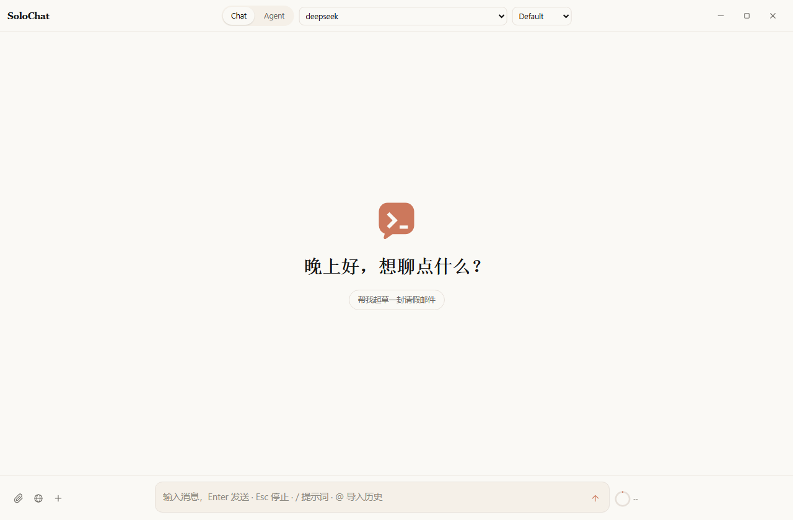
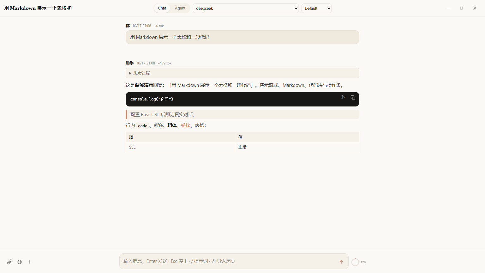
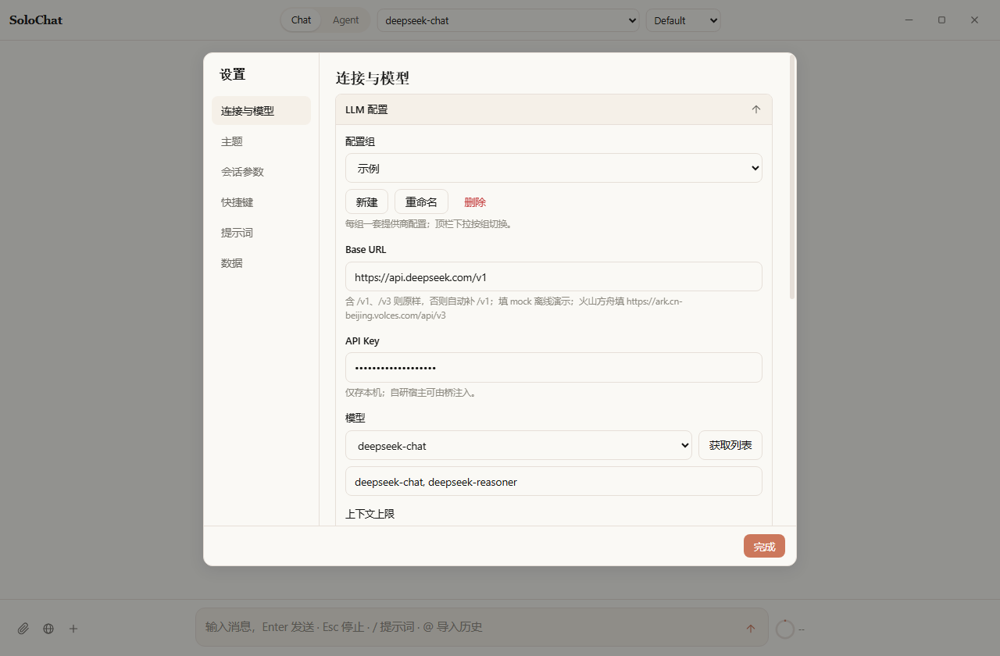

# SoloChat

**一个 2.14 MB 的 exe，双击就是一个完整的本地 AI 聊天客户端。**

没有安装器、没有 npm、没有构建步骤、没有云端。整个应用——界面、逻辑、图标、样式——全部内联在一个 `index.html` 里；配上宿主壳后发布成**单个 2.14 MB 的 `SoloChatHost.exe`**，托管 DLL、原生加载器、页面统统嵌进这一个文件。拷到任何一台 Win10/11 机器，双击即用。



## 为什么值得

| 事实 | 数字 |
|---|---|
| 发布产物 | **单个 2.14 MB exe**（全内嵌，零散落依赖） |
| 应用真实内存占用 | **~85 MB** 活动专用工作集（实测，非虚高口径） |
| 数据存放 | **100% 本机**——IndexedDB + localStorage，不上传、无遥测 |
| 外部依赖 | 仅系统预装的 WebView2 Runtime（Win10/11 自带，边际成本 0） |
| 源码可读性 | 整个应用 = **一个 `index.html`**，任何编辑器打开即可读/改 |

它不是又一个 Electron 壳。没有几百 MB 的运行时、没有 node_modules、没有后台守护进程。你拿到的是一个**能直接读完的单文件**，和一个**能直接拷走的单 exe**。

## 特性

- **单文件架构** — CSS / JS / SVG 图标全内联在一个 `index.html`，浏览器双击即用
- **多配置组** — 一套界面管多组提供商（Base URL / Key / 模型 / 上下文上限），顶栏下拉切换，兼容任意 OpenAI 风格接口
- **流式对话** — SSE 流式渲染 + 中断/重试/继续；重新生成用**原地覆盖 + 多版本切换**（`< 2/3 >`）
- **上下文圆环** — 输入框右侧实时 prompt token 占比，悬浮看精确值与**缓存命中率**，≥70% 黄 / ≥90% 红预警
- **自动压缩** — 上下文到 80% 自动触发：早期对话提炼为 **9 段结构化摘要**，无缝续写
- **提示词库** — 设置页卡片管理，输入区 `/` 唤起插入
- **Markdown 渲染** — 表格 / 代码块（一键复制）/ 引用 / 高亮齐全，思考过程可折叠
- **Agent 模式** — 宿主内选本地目录，模型经 `fs-list / fs-read / fs-write` 文本协议读写文件，写入需确认
- **联网搜索** — Serper / Tavily / Firecrawl 三通道注入当次上下文
- **其他** — 深/浅双主题、Alt+Space 全局呼出（宿主）、侧栏分组置顶、快捷键自定义、导入导出、`mock` 离线演示

## 截图

| 对话 | 设置 |
|---|---|
|  |  |

## 快速开始

### 方式一：浏览器直接用

双击 `index.html`，在 **设置 → 连接与模型** 填任意 OpenAI 兼容接口：

| 字段 | 说明 |
|---|---|
| Base URL | 例 `https://api.deepseek.com/v1`；已含 `/v1`、`/v3` 原样用，否则自动补全；填 `mock` 进离线演示 |
| API Key | 仅存本机 localStorage，不上传 |
| 模型 | 手动填或「获取列表」拉取 |

> 浏览器直连可能受 CORS 限制；受阻时用宿主方式，或自建透传。

### 方式二：单文件宿主（Windows，推荐）

需要 .NET SDK：

```powershell
dotnet publish host/SoloChatHost.csproj -c Release -o dist
```

产出 **单个 `dist/SoloChatHost.exe`**（托管 DLL + WebView2Loader + index.html 全嵌入）。双击运行，获得：Alt+Space 全局呼出并聚焦、文件 Agent 本地目录访问、受限网络下的请求桥。

## 数据存储

| 内容 | 位置 |
|---|---|
| 会话 / 消息 / 提示词 | IndexedDB（库名 `ai-chat`） |
| 配置与 API Key | localStorage（键 `sc.cfg.v1`） |

- 数据按**页面来源（origin）隔离**，不写入 html 本身，也不在任何"缓存"里
- 换浏览器、清数据、改路径都会看不到旧数据——长期数据请定期在 **设置 → 数据 → 导出** 备份

## 引擎选型：一次较真的评估

我们不满足于"能跑就行"，对替换 WebView2 的候选引擎 **Sciter** 做了逐层实测（不是纸面调研）：

| 维度 | WebView2 | Sciter |
|---|---|---|
| 引擎磁盘 | **868 MB** Runtime（系统级） | **18 MB** `sciter.dll` |
| 发布形态 | 单 exe + 依赖系统预装 Runtime | 单 dll + 页面 |
| 真实内存（活动专用） | ~85 MB | ~92 MB（基本打平） |
| 流式 SSE | 原生支持 | `fetch` 无流式（`body=null`） |
| 存储栈 | IndexedDB + localStorage | **两者皆无**，`@storage` 建库失败、`@sys` API 不可枚举 |

**结论（诚实版）**：Sciter 在**磁盘（47 倍）和架构简洁性**上是压倒性优势，但**内存两者打平**（Sciter 并无内存优势），且其**存储栈在裸环境不可用、流式缺失**——移植需重建整套持久化层，是独立专项，不值得为省磁盘冒险。当前交付 **WebView2 单 exe** 是工程上最稳的选择。这份评估的完整数据与过程见开发记录。

## 项目结构

```
OpenPage/
├── index.html                        # 核心：单文件聊天客户端（唯一运行时）
├── host/
│   ├── Program.cs                    # WebView2 宿主（托盘 / 热键 / 桥 / 文件访问）
│   ├── SoloChatHost.csproj           # 单文件发布：全部依赖内嵌
│   └── app.ico
├── dist/SoloChatHost.exe             # 发布产物（单文件，2.14 MB）
├── screenshots/                      # README 截图
├── 单文件AI聊天客户端-开发规范.md      # 架构与红线规范
└── .gitignore
```

## 开发

- 硬约束见 `单文件AI聊天客户端-开发规范.md`：单文件 ≤ 1 MB（1048576 字节）、总行数 ≤ 12000、零外部依赖、内联脚本按 §4.1 分区编号
- 自检：**体积 + 语法双检查**通过后才可部署到 `dist/index.html`
- 会话备份（`idb-backup/`）、开发日志、本机配置均被 `.gitignore` 排除

## 安全

已做安全加固（F1–F5）：日志不落消息原文与密钥（DEBUG 才有，含脱敏 + 1MB 滚动）、Release 无调试端口、无 PDB 泄露源路径、API Key 走 DPAPI 加密保险库、导出可选脱敏分享。

## 许可

本项目暂未声明开源许可证；公开前请自行补充 `LICENSE` 文件。
